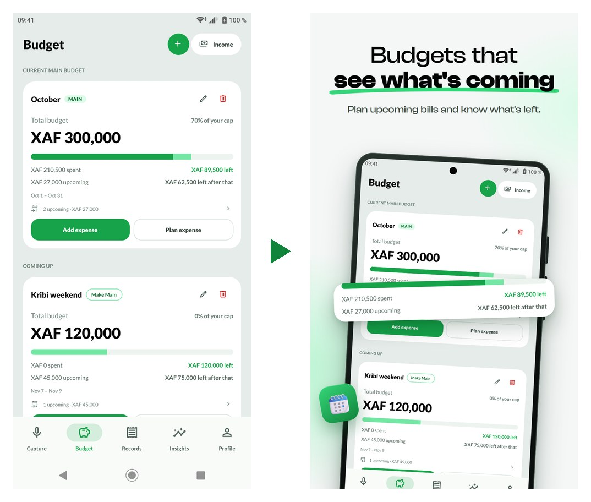
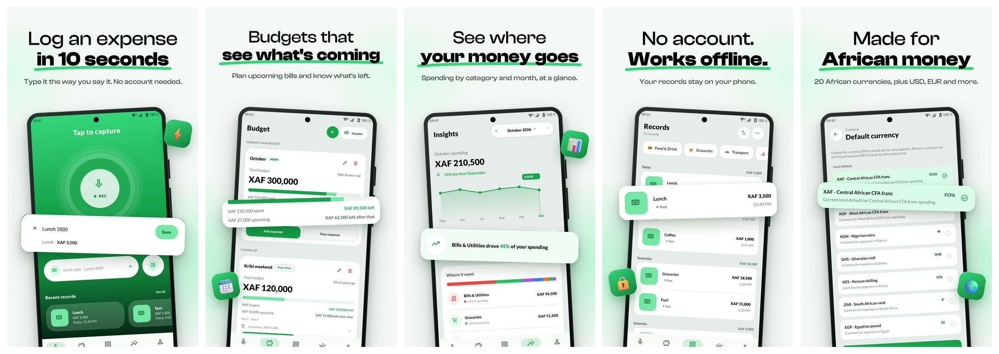
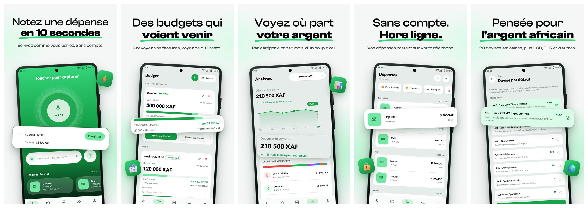
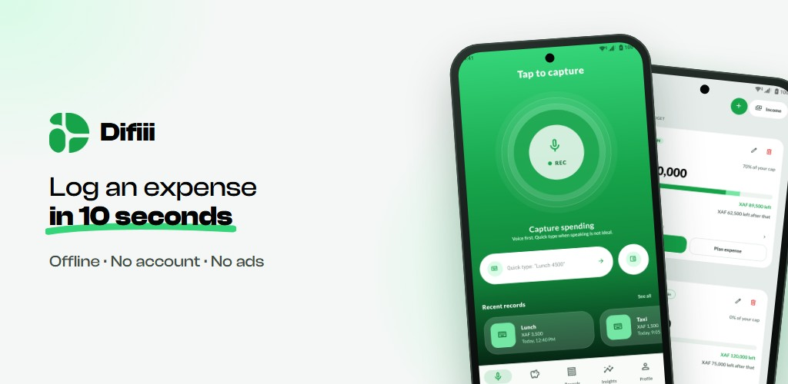
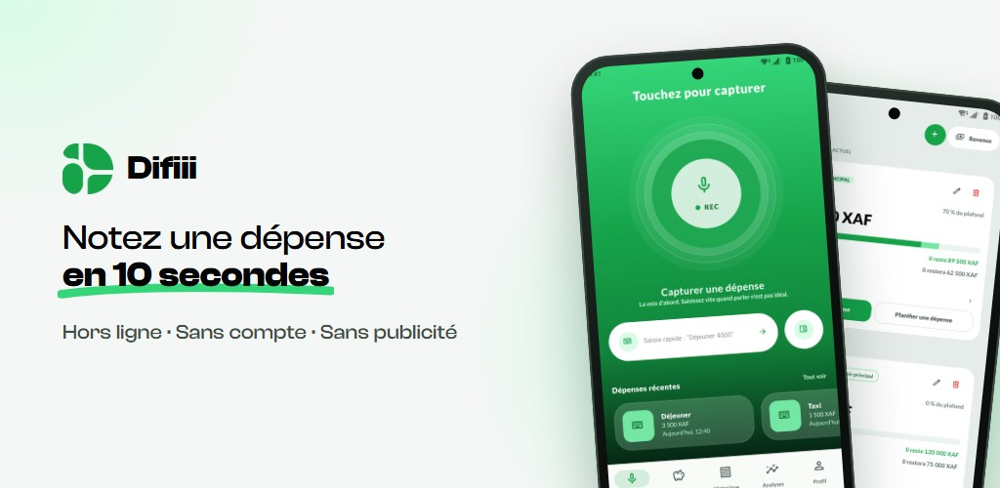

# Example: Difiii

Difiii is an offline-first expense tracker (Expo + React Native) with French as the default
language and an English listing. This is its first Google Play listing, produced with this
skill from a debug build running on a physical Android phone (Sony Xperia, 1080×2160).

## Raw capture → store screenshot

## Phone screenshots (1080×1920)

English:

French:

## Feature graphics (1024×500)

## Files

| File | What it is |
|---|---|
| [`screenshots.config.json`](screenshots.config.json) | The config `build-screenshots.mjs` used: slides, captions per language, crop boxes, per-language crop overrides, feature graphic |
| [`store/store.json`](store/store.json) | Android + iOS listing data for `fr-FR` and `en-US`, with asset paths and the App content answers |
| [`store/listing/android/fr-FR.txt`](store/listing/android/fr-FR.txt) | Copy-ready text for Play Console, every field under a heading with its character count |
| [`store/listing/android/en-US.txt`](store/listing/android/en-US.txt) | The same, English |
| [`store/listing/ios/`](store/listing/ios/) | App Store Connect text (name, subtitle, promotional text, description, keywords) |

Not included: the raw captures and the brand font (Clash Display), so the config is for
reading, not for rebuilding these exact images.

## Things the process caught

- The draft listing promised "category limits" for budgets. The claims ledger found no such
  feature in the code, and the line was removed before it reached the store.
- In French, the built-in category names were still in English. The French insights slide lifts
  the monthly total instead of the category pill, and the gap was reported to the developer.
- Android's backup rules exclude the app's database, so records don't follow users to a new
  phone. The privacy policy says so plainly.
